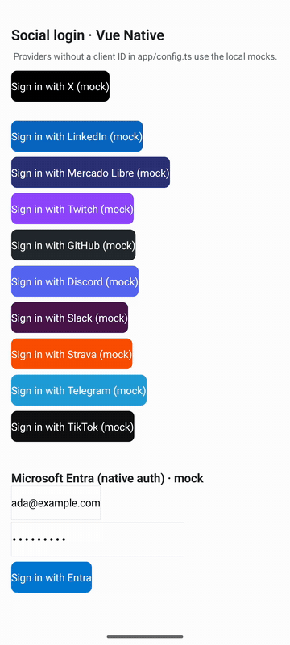

# @franciscodlxdev/vue-native-auth-core

<p align="center"></p>

OAuth 2.0 + PKCE para Vue Native ([vue-native.dev](https://www.vue-native.dev), iOS y Android) en el navegador del sistema: `ASWebAuthenticationSession` en iOS y Custom Tabs en Android. Sin WebView y sin `clientSecret` en la app. Es el núcleo de la familia: cada proveedor (LinkedIn, X, GitHub, …) es un paquete aparte que solo aporta endpoints, scopes y el mapeo del perfil.

> No confundir con el Vue Native de GeekyAnts (sobre React Native, abandonado desde 2021). Este paquete es para el framework de [vue-native.dev](https://www.vue-native.dev), que renderiza a UIKit y Android Views.

## Compatibilidad

| Paquete | Vue Native       | Vue    | iOS    | Android        |
| ------- | ---------------- | ------ | ------ | -------------- |
| 0.1.x   | 0.23.3 (probado) | 3.5.40 | ≥ 16.0 | ≥ 5.0 (API 21) |

Vue Native es pre-1.0 y cambia rápido: el `peerDependency` acepta `>=0.23.3 <1`, pero solo 0.23.3 está probado.

## Instalación

```sh
pnpm add @franciscodlxdev/vue-native-auth-core
npx vue-native-social-login setup --scheme miapp
```

Después vuelve a compilar la app (`vue-native run ios` / `android`).

### Qué hace `setup`

Vue Native genera los módulos nativos desde bloques `<native>` de los `.vue` **de tu app**; su codegen nunca lee `node_modules`. Por eso el código Swift y Kotlin de este paquete no puede quedarse en `node_modules`, y `setup`:

1. Copia `app/native/SocialLoginAuthSession.vue`: el módulo nativo (`ASWebAuthenticationSession` en Swift; Custom Tabs y las dos actividades del redirect en Kotlin, sin depender de `androidx.browser`). No lo edites: `setup` lo sobrescribe al actualizar el paquete, así que vuelve a correrlo después de cada actualización.
2. En Android agrega a `android/app/src/main/AndroidManifest.xml`, entre comentarios `vue-native-social-login:start/end`, las actividades, un `intent-filter` con tus esquemas y las `<queries>` para encontrar navegadores en Android 11+. Si lo corres otra vez, reemplaza ese bloque en lugar de duplicarlo.

Opciones: `--scheme a,b` para varios esquemas, `--https-host auth.miapp.com` para un App Link verificado, y `--root` si no lo corres desde la raíz de la app.

**iOS** no necesita nada más: `ASWebAuthenticationSession` recibe `miapp://…` sin registrar el esquema en `Info.plist`.

Si el módulo no está en la app, `signIn` falla con `NOT_SUPPORTED` y el mensaje te indica correr `setup`. Si en Android falta el esquema en el manifiesto, falla de inmediato con `INVALID_CONFIG` en lugar de dejar el navegador abierto sin regreso.

## Configurar el proveedor

1. Crea la app en el portal del proveedor como cliente **público / nativo** (sin secret).
2. Registra el redirect URI: `miapp://callback`, o un Universal Link / App Link.
3. Anota el `clientId` y los scopes.

## Uso

```ts
import { createProviderLogin } from '@franciscodlxdev/vue-native-auth-core';

const login = createProviderLogin({
  id: 'mi-idp',
  authorizationEndpoint: 'https://idp.example.com/authorize',
  tokenEndpoint: 'https://idp.example.com/token', // solo si el proveedor admite clientes públicos
  userInfoEndpoint: 'https://idp.example.com/userinfo',
  issuer: 'https://idp.example.com',
  defaultScopes: ['openid', 'profile', 'email'],
  useNonce: true,
});

const { code, codeVerifier, nonce, redirectUri } = await login.signIn({
  clientId: 'TU_CLIENT_ID',
  redirectUri: 'miapp://callback',
});
// Envía code + codeVerifier + redirectUri a tu backend.
```

### Composable de Vue

`useProviderLogin` envuelve cualquier proveedor con estado reactivo (la misma API que el hook de React Native):

```vue
<script setup lang="ts">
import { useProviderLogin } from '@franciscodlxdev/vue-native-auth-core';
import { githubLogin } from '@franciscodlxdev/vue-native-oauth-presets';

const github = useProviderLogin(githubLogin, {
  clientId: 'TU_CLIENT_ID',
  redirectUri: 'https://api.miapp.com/auth/github/callback',
  callbackUri: 'miapp://callback',
});
// github.signIn(), github.loading, github.result, github.error (AuthError | null)
</script>

<template>
  <VButton :disabled="github.loading.value" :onPress="() => github.signIn()">
    <VText>Continuar con GitHub</VText>
  </VButton>
</template>
```

`signIn()` resuelve con el resultado o con `null` si falló (mira `error`). Las opciones pueden ser un objeto, un `ref` o un getter.

### API

| Función                                                              | Devuelve                                                                                                                                                           |
| -------------------------------------------------------------------- | ------------------------------------------------------------------------------------------------------------------------------------------------------------------ |
| `signIn(options)`                                                    | `{ code, codeVerifier, state, nonce?, redirectUri, params }`; con `exchangeCode: true` agrega `accessToken`, `refreshToken`, `idToken`, `idTokenClaims`, `profile` |
| `signOut({ clientId, token })`                                       | Revoca el token si el proveedor tiene endpoint de revocación                                                                                                       |
| `isAvailable()`                                                      | `Promise<boolean>`: si se puede abrir el navegador del sistema                                                                                                     |
| `authorize(request)` / `cancelAuthorize()`                           | El flujo sin proveedor predefinido / cerrar el navegador abierto                                                                                                   |
| `exchangeCode`, `refreshAccessToken`, `revokeToken`, `fetchUserInfo` | Llamadas de cliente público al proveedor                                                                                                                           |
| `decodeIdToken`, `validateIdTokenClaims`                             | Claims del `id_token` y revisión de `iss`, `aud`, `exp`, `nonce`                                                                                                   |
| `createPkcePair()`, `randomString()`                                 | PKCE S256 y aleatorios del CSPRNG de la plataforma (asíncronos)                                                                                                    |
| `useProviderLogin(login, options)`                                   | Composable de Vue: `signIn`, `signOut`, `loading`, `result`, `error`, `isAvailable`                                                                                |

Opciones de `signIn`: `clientId`, `redirectUri`, `callbackUri`, `scopes`, `extraParams`, `prefersEphemeralSession` (no comparte cookies con el navegador; en iOS además evita el aviso de confirmación), `exchangeCode`.

### Proveedores que solo aceptan redirect https

Si el proveedor no admite `miapp://…`, registra una URL https de tu backend como `redirectUri` y haz que reenvíe la query a tu app; `callbackUri` es la URL donde la app espera:

```ts
login.signIn({
  clientId,
  redirectUri: 'https://api.miapp.com/auth/callback', // lo ve el proveedor
  callbackUri: 'miapp://callback', // lo recibe la app
});
```

## Backend (canje del código)

Si el proveedor exige `client_secret`, el canje va en tu servidor. Node/Express:

```js
app.post('/auth/exchange', async (req, res) => {
  const { code, codeVerifier, redirectUri } = req.body;
  const r = await fetch('https://idp.example.com/token', {
    method: 'POST',
    headers: { 'Content-Type': 'application/x-www-form-urlencoded' },
    body: new URLSearchParams({
      grant_type: 'authorization_code',
      code,
      code_verifier: codeVerifier,
      redirect_uri: redirectUri,
      client_id: process.env.CLIENT_ID,
      client_secret: process.env.CLIENT_SECRET,
    }),
  });
  res.status(r.status).json(await r.json());
});
```

## Errores normalizados

Todo falla con un `AuthError` cuyo `code` es uno de:

| Código           | Cuándo                                                                                                      |
| ---------------- | ----------------------------------------------------------------------------------------------------------- |
| `CANCELLED`      | El usuario cerró el navegador o rechazó el permiso (`access_denied`)                                        |
| `NETWORK`        | No se pudo contactar al proveedor                                                                           |
| `INVALID_CONFIG` | Falta `clientId` / `redirectUri`, endpoint sin https, esquema sin `intent-filter` o ya hay un login abierto |
| `PROVIDER_ERROR` | El proveedor devolvió un error, el `state` no coincide o el `id_token` no es válido                         |
| `NOT_SUPPORTED`  | Sin navegador, sin el módulo nativo (falta `setup`), o redirect https en iOS < 17.4                         |

`error.providerError` y `error.providerErrorDescription` traen lo que respondió el proveedor.

## Seguridad

- No hay `clientSecret` en la app: PKCE (S256) liga el código al dispositivo que lo pidió.
- `state`, `nonce` y el verificador PKCE salen de `crypto.getRandomValues` (CSPRNG de la plataforma); un redirect con otro `state` se rechaza. El runtime no trae `crypto.subtle`, así que SHA-256 está implementado en TypeScript.
- En Android solo se acepta el redirect del inicio de sesión en curso (mismo esquema, host y ruta).
- El `id_token` se decodifica **sin verificar la firma**; verifícala en tu backend.
- La librería no guarda tokens. Usa `useSecureStorage()` del runtime de Vue Native (Keychain / Keystore).
- http solo se acepta hacia `localhost`, `127.0.0.1` y `10.0.2.2`, para el servidor de pruebas.

Más en [SECURITY.md](../../SECURITY.md).

## Probar sin credenciales

`examples/demo` (Vue Native) corre todos los proveedores contra `tools/mock-idp`, un proveedor OIDC local. Ver [CONTRIBUTING.md](../../CONTRIBUTING.md).

## Licencia

MIT
